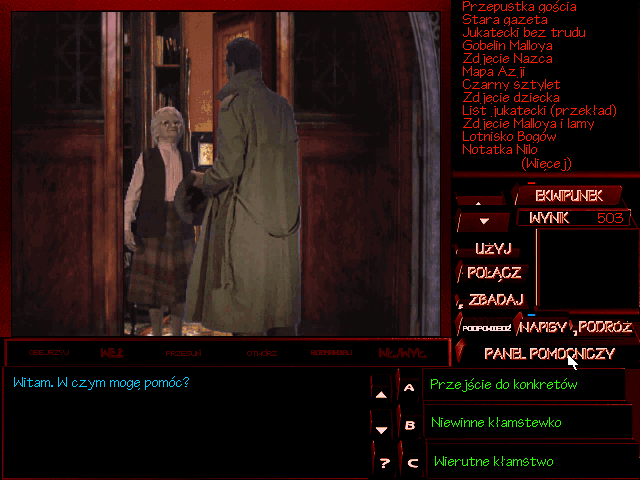
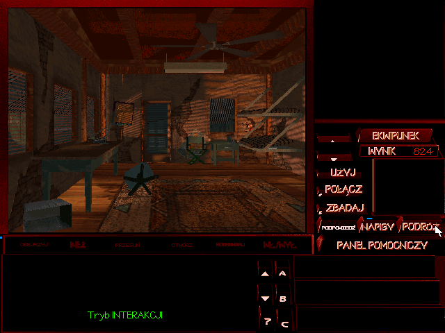
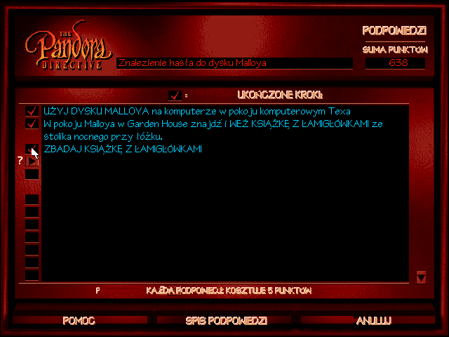
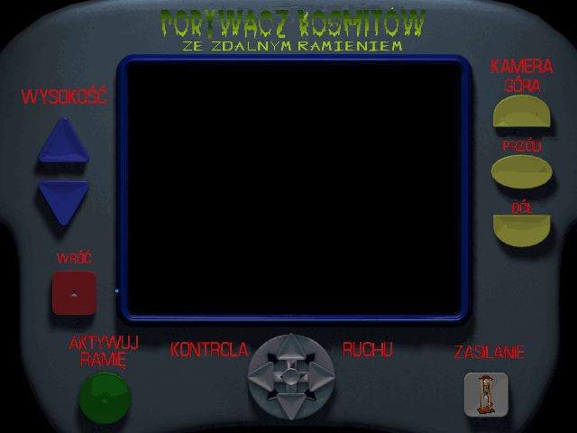
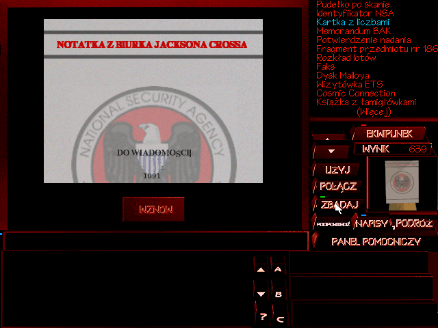
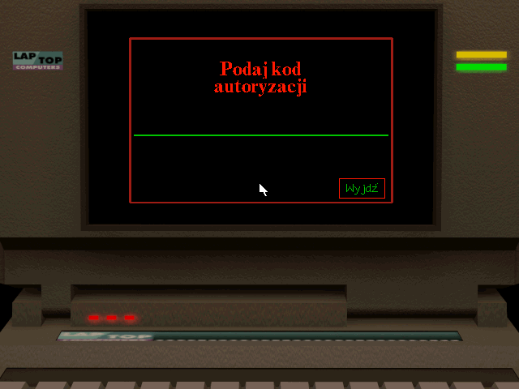

# The Pandora Directive — Spolszczenie PL

Fanowska polska lokalizacja gry, autorstwa **marko22**.

## Ważna informacja — wersja 0.9.0 Beta

Oddaję w Wasze ręce polskie tłumaczenie The Pandora Directive, obejmujące cały zidentyfikowany korpus tekstowy gry — 94 643 słowa angielskiego tekstu źródłowego.

Pomimo przeprowadzenia obszernych testów językowych i technicznych, ze względu na ograniczony czas nie miałem możliwości samodzielnego przejścia całej gry od początku do końca. Z tego właśnie powodu zdecydowałem się udostępnić spolszczenie jako wersję beta.

Na tym etapie liczę na Waszą pomoc. Szczególnie zależy mi na osobach, które zechcą przejść całą grę z polskim tłumaczeniem, w miarę możliwości również różnymi ścieżkami fabularnymi.

Będę wdzięczny za zgłaszanie wszelkich zauważonych nieprawidłowości, w szczególności:

- błędów językowych i tłumaczeń niepasujących do kontekstu;
- nieprzetłumaczonych fragmentów tekstu;
- nieprawidłowo wyświetlanych polskich znaków;
- uciętych lub nachodzących na siebie tekstów;
- problemów z zagadkami, podpowiedziami i interfejsem;
- niezgodności napisów z wypowiedziami postaci;
- problemów uniemożliwiających dalszą rozgrywkę.

Jeżeli to możliwe, do zgłoszenia dołączcie zrzut ekranu oraz krótki opis miejsca i okoliczności wystąpienia błędu.

Każda uwaga będzie dla mnie cenna i pomoże dopracować spolszczenie przed wydaniem finalnej wersji 1.0.0.

Z góry dziękuję wszystkim, którzy zdecydują się pomóc w tym ostatnim etapie projektu.

Życzę udanej rozgrywki!

**marko22**

## 📦 Aktualne wydanie

**v0.9.0 Beta** · 25.11.2026 · Windows / Steam

➡️ [Pobierz najnowszą wersję](https://github.com/mariuszm22/The-Pandora-Directive-Spolszczenie-PL/releases/tag/v0.9.0-beta)

- [EXE — instalator automatyczny](https://github.com/mariuszm22/The-Pandora-Directive-Spolszczenie-PL/releases/download/v0.9.0-beta/marko22-Instalator-Pandora-PL-0.9.0-Beta.exe) · 13,12 MB
- [ZIP — instalacja ręczna](https://github.com/mariuszm22/The-Pandora-Directive-Spolszczenie-PL/releases/download/v0.9.0-beta/Pandora_PL_0.9.0-Beta.zip) · 9,67 MB
- [Sumy SHA-256](https://github.com/mariuszm22/The-Pandora-Directive-Spolszczenie-PL/releases/download/v0.9.0-beta/pandora-0.9.0-beta.sha256)

## Windows SmartScreen / instalator EXE

Windows może wyświetlić komunikat SmartScreen przy uruchamianiu EXE bez komercyjnego podpisu cyfrowego. Sumę pobranego pliku możesz porównać z dołączonym spisem SHA-256. Dostępna jest również instalacja ręczna z ZIP.

## 📷 Zrzuty ekranu

## 📋 Zawartość tłumaczenia

- Cały zidentyfikowany korpus tekstowy gry, obejmujący 94 643 słowa języka angielskiego.
- Polskie napisy dialogów, menu, interfejs, pomoc, podpowiedzi i opisy przedmiotów.
- Polskie znaki i wybrane zlokalizowane grafiki, w tym panel Abductora.
- Oryginalna angielska ścieżka głosowa.

**Zgodność** — angielska wersja Steam dla Windows, AppID 302360, BuildID 470847. Wymagana jest własna kopia gry.

## ⚙️ Instalacja

1. Zamknij grę i DOSBox. Uruchom **marko22-Instalator-Pandora-PL-0.9.0-Beta.exe**.
2. Wybierz **Zainstaluj spolszczenie**. Zatwierdź wykryty folder Steam lub wskaż katalog `Tex Murphy 4` zawierający folder `TEX4`.
3. Sprawdź podsumowanie i zatwierdź instalację. Kreator sprawdza zgodność plików i zapisuje kopie oryginałów.

Uruchom grę przez Steam. Spolszczenie jest aktywne od początku.

Przy [instalacji ręcznej](https://github.com/mariuszm22/The-Pandora-Directive-Spolszczenie-PL/releases/download/v0.9.0-beta/Pandora_PL_0.9.0-Beta.zip) wypakuj ZIP do osobnego folderu i wykonaj kroki z **README_PL.txt**. [Pełna instrukcja instalacji](INSTALACJA.md).

## 🗑️ Deinstalacja

Przy zamkniętej grze i DOSBoxie wybierz **Odinstaluj spolszczenie i przywróć oryginały** w kreatorze. Przy instalacji ręcznej użyj skryptu z ZIP z operacją `Przywroc`.

## 🐞 Zgłaszanie błędów

Użyj [GitHub Issues](https://github.com/mariuszm22/The-Pandora-Directive-Spolszczenie-PL/issues). Podaj wersję, dzień lub lokację, okoliczności i kroki odtworzenia. Jeśli możesz, dołącz zrzut ekranu.

## ⚠️ Informacja

[Strona projektu i galeria](https://marko22.pl/pandora) · [Pobieranie na marko22.pl](https://marko22.pl/pobieranie#pandora) · [Gra na Steam](https://store.steampowered.com/app/302360/)

Autor spolszczenia i redakcja — **marko22**. Projekt fanowski. Prawa do gry i jej grafiki należą do ich właścicieli.

## 🎮 Miłej gry!
